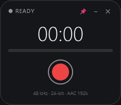

# Voice Recorder (pyvoicerecorder)



`pyvoicerecorder` is a Python-based GUI viewer built with PyQt, designed for reocrder meeting minutes by use computer microphone.

## Project Structure

```
pyvoicerecorder/
├── recorder_m4a.py          # Main application: Voice recorder GUI
├── build_exe.bat            # Windows batch script for building the .exe executable
├── rec_256x256.ico          # Application icon (ICO format)
└── requirements.txt         # Python dependencies list
```

## Prerequisites & Installation

### 1. Python Environment

Ensure Python 3.8 or above is installed on your system.

### 2. Install Dependencies

Install the required packages by running the following command in the project root directory:

```bash
pip install -r requirements.txt
```

## Usage

### Running the GUI Application

Launch the application using Python:

```bash
python recorder_m4a.py
```

## Building Standalone Executable (.exe)

This project supports packaging into a standalone `.exe` executable for Windows using [PyInstaller](https://pyinstaller.org/).

### Method: Automated Build via Batch Script

On Windows, double-click `build_exe.bat` or run it from the Command Prompt (CMD):

```cmd
build_exe.bat
```

Once the build process finishes, the compiled executable will be located in the `dist/` folder.

## License

This project is for internal use / licensed under project-specific terms.